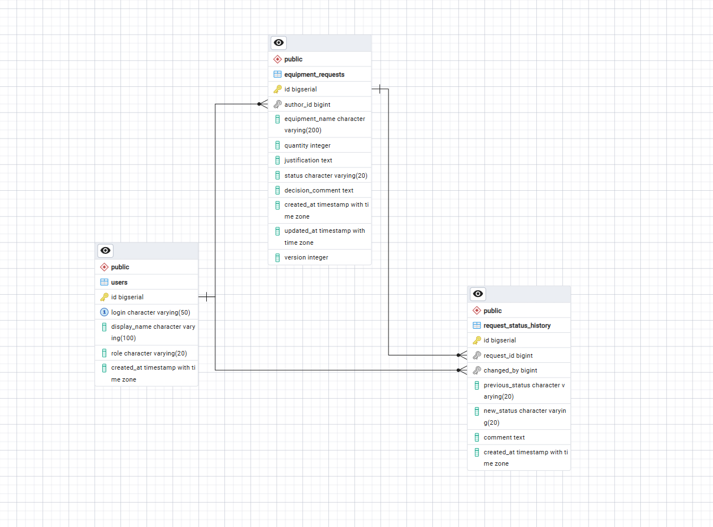

# Equipment Request Service

Сервис заявок на оборудование. Сотрудники создают заявки, ответственные рассматривают их и принимают решение об одобрении или отклонении.

## Технологии

- Java 17
- Spring Boot 3.3.5
- Maven
- PostgreSQL
- Spring Data JPA
- Bean Validation
- Flyway (миграции схемы БД)

## Требования

Для запуска необходимо наличие установленного JDK 17, Maven и локального сервера PostgreSQL.

## Подготовка базы данных

Перед первым запуском создайте базу данных `equipment_service`:

1. Откройте pgAdmin 4.
2. Раскройте Servers → PostgreSQL.
3. Правой кнопкой по Databases → Create → Database.
4. Введите имя: `equipment_service`.
5. Нажмите Save.

## Переменные окружения

Учетные данные для подключения к базе передаются через переменные окружения. Значения по умолчанию отсутствуют, поэтому приложение не запустится без их установки.

| Переменная  | Описание |
|-------------|----------|
| DB_USERNAME | Пользователь PostgreSQL |
| DB_PASSWORD | Пароль пользователя PostgreSQL |

## Сборка и запуск

Откройте терминал в корне проекта и выполните команды последовательно:

```bash
set DB_USERNAME=<ваше_имя_пользователя>
set DB_PASSWORD=<ваш_пароль>
mvn spring-boot:run
```

Приложение стартует на порту 8080. О готовности свидетельствует сообщение Started EquipmentRequestServiceApplication в логах.

## Проверка работоспособности

После запуска выполните запрос к техническому эндпоинту:

```bash
curl http://localhost:8080/ping
```

Или откройте в браузере: http://localhost:8080/ping

Ожидаемый ответ: OK

## Схема БД и API-контракт

### Структура базы данных
Создаётся автоматически миграцией Flyway `V1__init_schema.sql` при первом запуске
на пустой БД; повторный запуск безопасен (Flyway ведёт журнал в `flyway_schema_history`).
Таблицы: `users`, `equipment_requests`, `request_status_history`.
Ограничения в БД: уникальный логин (`UNIQUE`), внешние ключи на автора/заявку/исполнителя
(`FOREIGN KEY`), `CHECK` на положительное количество и на допустимые статусы/роли,
обязательные даты (`NOT NULL DEFAULT now()`). История статусов — event-log:
каждый переход отдельной строкой (`previous_status` / `new_status` / `changed_by` / `comment` / `время`).
Hibernate работает в режиме `validate` — только сверяет схему, не меняет её.

## Схема связей (ERD)




## API
Контракт всех 9 операций с разделением клиентских/серверных полей и примерами JSON —
в файле [`API_CONTRACT.md`](API_CONTRACT.md). Формат дат в API — ISO 8601 UTC (`...Z`).

## Как запустить миграцию
```cmd
set DB_USERNAME=<ваше_имя_пользователя>
set DB_PASSWORD=<ваш_пароль>
mvn spring-boot:run
```
После старта в pgAdmin → Schemas → public → Tables появятся три таблицы + `flyway_schema_history`.